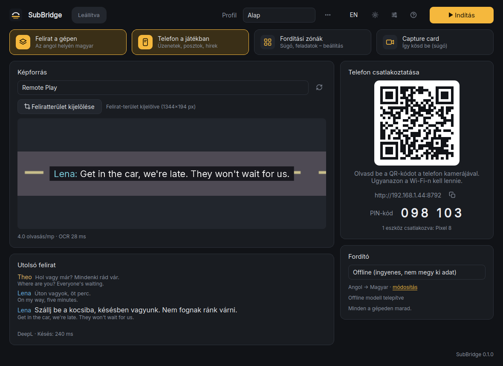
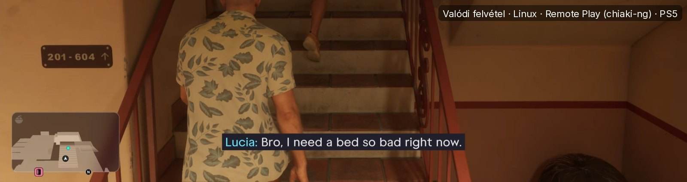
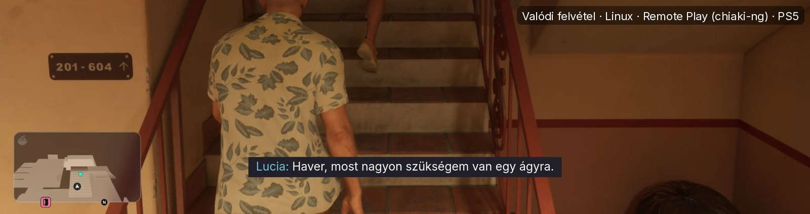
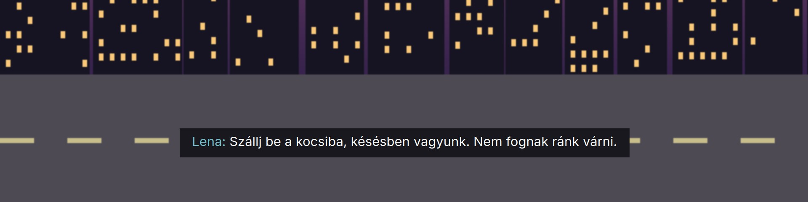
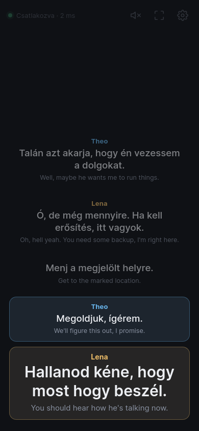
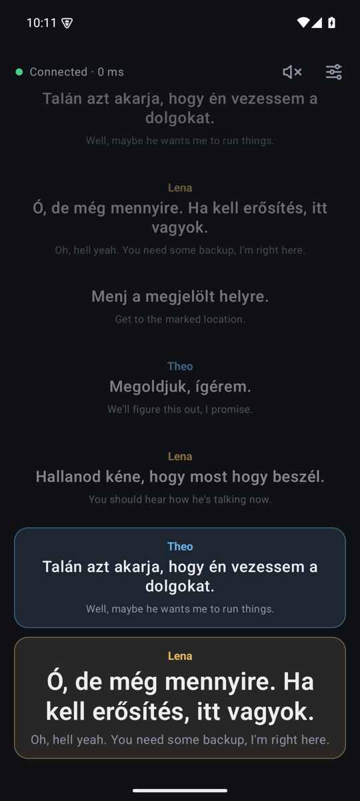

<p align="center">
  
</p>

<h1 align="center">SubBridge</h1>
<p align="center"><b>Játékfeliratok élő fordítása – a képernyőn és a telefonodon.</b><br>
Live game subtitle translation – on your screen and on your phone.</p>

<p align="center">
  <a href="#magyar">Magyar</a> · <a href="#english">English</a> · <a href="https://rolandhrvth.hu/subbridge">rolandhrvth.hu/subbridge</a>
</p>

<p align="center"></p>

---

## Magyar

A SubBridge kiolvassa a játék angol feliratát a képből, lefordítja (alapból magyarra), és megmutatja
**a játék képén az eredeti helyén**, **a telefonodon** – vagy mindkettőn. Bármilyen játékkal működik, amelyik
feliratot jelenít meg.

### Mit tud

- **Felirat a játék képén.** A fordítás pontosan az angol feliratdoboz helyére kerül, ugyanolyan dobozban, a
  beszélő nevének eredeti színével. Csak akkor látszik, ha a játékablak van elöl.
- **Játssz a tévén, olvasd a telefonon.** Ha nem szeretsz a gépen (Remote Playjel) játszani, játssz a tévén a
  konzollal: a SubBridge a háttérben olvas, a fordítás a monitor alá vagy az asztalra tett telefonodon jelenik meg.
  A program **csak olvassa** a képet – a játékban és a Remote Playben az eredeti felirat ugyanúgy megmarad.
- **Beszélgetésnézet a telefonon.** Minden beszélőnek saját színe van, a legújabb sor nagy, a még látható sorok
  kiemelve, felolvasás (TTS) is kérhető.
- **Játékbeli telefon fordítása.** Üzenetek, chatek, közösségi posztok, hírek és válaszgombok – a játékban elővett
  telefon mellett és a saját telefonodon is.
- **Fordítási zónák.** Súgódobozok, feladatszövegek, értesítések – mindegyik külön területként.
- **Capture card támogatás.** Bármilyen USB-s HDMI-rögzítő (UVC): Elgato, olcsó 4K HDMI→USB adapterek. Beépített
  **Játéknézet** a passthrough nélküli kártyákhoz: teljes képernyő, hang, magyar felirat a képben.
- **Offline és ingyenes** alapból, vagy saját kulccsal **DeepL**, **Google Cloud** (hivatalos API), **LibreTranslate**.
- **Profilok játékonként**, szószedet (nevek, kifejezések), sötét/világos téma, magyar/angol felület.
- **Gyors:** felirat megjelenésétől a telefonig jellemzően 0,2–0,4 másodperc.

**Valódi felvétel · Linux · Remote Play (chiaki-ng) · PS5** — angol eredeti / magyar SubBridge-dzsel:




| A játék képén (szemléltető) | Telefon (web) | Android-app |
|---|---|---|
|  |  |  |

### Telepítés

Töltsd le a legfrissebb kiadást a [Releases](../../releases) oldalról:

- **Windows:** `SubBridge-Setup-x.y.z.exe`
- **Linux (Mint/Ubuntu/Debian):** `subbridge_x.y.z_amd64.deb` – `sudo apt install ./subbridge_*.deb`
- **Android:** `SubBridge-x.y.z.apk` – vagy app nélkül: olvasd be a QR-kódot, és a böngészőben fut (iPhone-on is).

Első indításkor egy háromlépéses varázsló végigvezet: forrás kiválasztása, feliratterület kijelölése, telefon
csatlakoztatása.

### Képforrás

| Forrás | Mikor |
|---|---|
| **Remote Play ablak** (pl. chiaki-ng) | A konzol képe a gépen fut. Takarásban is működik, csak ne legyen kicsinyítve. A chiaki-ng-t külön kell telepíteni. |
| **Capture card** | HDMI-rögzítővel. PS5-ön kapcsold ki a HDCP-t és a HDR-t, a felbontás legyen 1080p. |
| **Teljes képernyő** | Bármi más (PC-s játékok, videók). |

Részletes súgó a programban (? gomb): Remote Play beállítása, capture card bekötése, telefon, iPhone-tippek
(automatikus zárolás: „Soha”), HDMI dummy plug, ha a monitor átvált a konzol bemenetére.

### Adatvédelem

Minden a gépeden marad. Online fordító választásakor **csak a felirat szövege** megy a választott szolgáltatáshoz.
Nincs fiók, nincs felhő, nincs telemetria. Részletek: [PRIVACY.md](PRIVACY.md).

---

## English

SubBridge reads a game's subtitles from the picture, translates them and shows the translation **right where the
original subtitle is**, **on your phone**, or both. It works with any game that shows subtitles.

### Features

Real footage (Linux · Remote Play (chiaki-ng) · PS5): see the pictures above and the clip on the
[project page](https://rolandhrvth.hu/subbridge/).

- **Subtitles on the game picture** – the translation covers the original subtitle box, same style, speaker name
  in its original colour. Shown only while the game window is in front.
- **Play on the TV, read on your phone** – SubBridge reads in the background (Remote Play window or capture card)
  and your phone shows the translation. It only *reads* the picture: the original subtitles stay untouched.
- **Conversation view on the phone** – a colour per speaker, newest line large, lines still on screen highlighted,
  optional read-aloud.
- **In-game phone translation** – messages, chats, social posts, news and reply buttons.
- **Translation zones** – help boxes, objectives, notifications.
- **Capture cards** – any UVC HDMI capture device; built-in **Game View** (full screen, sound, translated subtitles)
  for cards without passthrough.
- **Offline and free** by default, or **DeepL**, **Google Cloud** (official API), **LibreTranslate** with your own key.
- Per-game **profiles**, glossary, dark/light theme, Hungarian/English UI. Typical latency 0.2–0.4 s.

### Install

Get the latest build from [Releases](../../releases): Windows installer, Linux `.deb`, Android `.apk`.
iPhone and other phones need no app – scan the QR code and it runs in the browser.

### Privacy

Everything stays on your computer. With an online translator **only the subtitle text** goes to that service.
No account, no cloud, no telemetry. See [PRIVACY.md](PRIVACY.md).

---

## Fejlesztés / Development

```bash
sudo apt install tesseract-ocr libxcb-cursor0        # Linux
uv venv .venv && uv pip install --python .venv -e ".[dev]"
.venv/bin/python -m subbridge                        # run
.venv/bin/python -m pytest                           # tests
```

| Tool | |
|---|---|
| `tools/replay.py <frames>` | replay recorded frames through the whole pipeline, prints latency |
| `tools/demo_server.py [port] [--phone]` | phone page with demo subtitles (`?k=demo`, PIN 123456) |
| `tools/vcam_test.py [/dev/videoN]` | capture card end-to-end test with a v4l2loopback device |
| `tools/docs_shots.py docs/img` | README screenshots from a synthetic scene |
| `pyinstaller packaging/subbridge.spec` · `packaging/build_deb.sh` | desktop builds |
| `cd android && ./gradlew assembleRelease` | Android app (JDK 17/21) |

```
capture (window / screen / capture card) → subtitle box detection → OCR → line tracker (stable, de-duplicated)
→ translation (cache + glossary) → overlay · Game View · local web server → WebSocket → phone / Android app
```

## Licenc / License

MIT – see [LICENSE](LICENSE). Third-party components: [THIRD_PARTY_LICENSES.md](THIRD_PARTY_LICENSES.md).
SubBridge is an independent project and is not affiliated with any game publisher or platform holder.
All trademarks belong to their owners.
